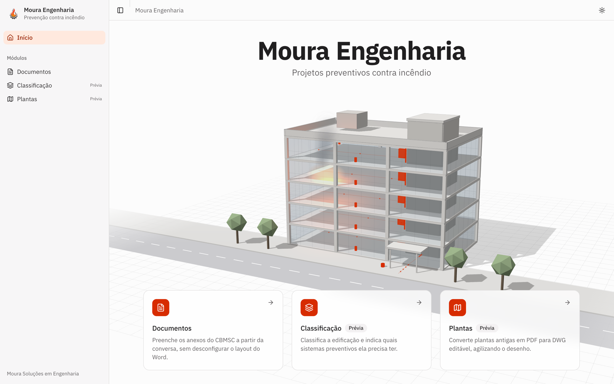
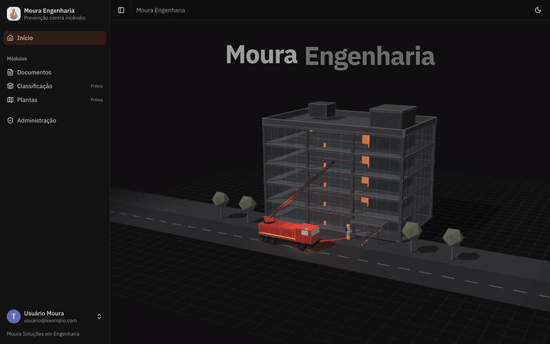

<div align="center">


# Moura AI

Internal platform for Moura Soluções em Engenharia, a fire-prevention engineering firm in Santa Catarina, that fills CBMSC forms, tracks PPCI reviews and drafts proposals for its projects.

[](https://github.com/tiagoponciano/Moura-AI/actions/workflows/ci.yml)

</div>



## Built with

<table>
<tr>
<td align="center" width="120"><br />TypeScript</td>
<td align="center" width="120"><br />Next.js</td>
<td align="center" width="120"><br />Tailwind CSS</td>
<td align="center" width="120"><br />Zod</td>
<td align="center" width="120"><br />Supabase</td>
<td align="center" width="120"><br />Vercel</td>
</tr>
<tr>
<td align="center" width="120"><br />Python</td>
<td align="center" width="120"><br />Docker</td>
<td align="center" width="120"><br />Claude</td>
<td align="center" width="120"><br />ChatGPT</td>
<td align="center" width="120"><br />Gemini</td>
</tr>
</table>

Claude, ChatGPT and Gemini are interchangeable: an admin picks the provider and model on `/admin`, and the code is the same for all of them.

## What it does

Preparing a fire-prevention project (PPCI) for the Santa Catarina fire department (CBMSC) means filling the same official `.docx` forms over and over, checking the project against a review checklist, and sending the client a proposal. Moura AI does that work inside one app, organized in three modules.

The model never writes a document. It extracts data from the conversation into a JSON object whose schema comes from code; deterministic code validates it and injects it into the original `.docx` template, so the layout the fire department expects is never touched.

| Module                  | Route             | Status  | What it does                                                                                                                                                                                                 |
| ----------------------- | ----------------- | ------- | ------------------------------------------------------------------------------------------------------------------------------------------------------------------------------------------------------------ |
| Documents               | `/documents`      | Working | Fills the CBMSC forms from a chat, saves each filling per project, keeps the shared project data and its change history, answers Moura's PPCI checklist, and generates the commercial proposal (`.pptx`/PDF) |
| Classification          | `/classification` | Preview | Lists the preventive systems a building needs from four answers (area, height, floors, occupancy). The rule set is provisional and is not the CBMSC Normative Instructions yet                               |
| Floor plans (PDF → DWG) | `/floor-plans`    | Preview | Uploads a floor plan (PDF, JPEG or PNG), reads its scale and converts it to DXF or DWG through the `services/dwg` microservice. Not tried on real Moura plans yet                                            |



Access is closed: people sign in with Google, an admin approves them on `/admin`, and the same screen sets the AI provider, model, API keys and the allowed e-mail domain.

## Running it locally

Tested with Node.js 24 and pnpm 10.33. CI uses Node 22+ and, for the proposal service, Python 3.13.

1. Install the dependencies from the repository root:

   ```bash
   pnpm install
   ```

2. Create the environment file:

   ```bash
   cp .env.example client/.env.local
   ```

3. Start the app:

   ```bash
   pnpm run dev
   ```

4. Open <http://localhost:3000>.

With the Supabase variables left empty, the app runs without login or persistence: the home page, Classification and the Floor plans screen work, but chats cannot answer and Documents shows only a placeholder, because the form catalog, projects and AI model settings live in Supabase. To turn those on, follow the Setup section of [`authentication.md`](client/docs/authentication.md): create the project, apply `supabase/migrations/` in filename order, configure Google in Supabase Auth and create the first admin with SQL. Then sign in, open "Administração", pick the AI provider and model and save its API key.

The three microservices are optional and run with Docker:

```bash
docker compose up -d pdf    # PDF output, http://localhost:3001
docker compose up -d pptx   # commercial proposal, http://localhost:3002
docker compose up -d dwg    # floor plan conversion
```

The local credentials for `client/.env.local` are in `docker-compose.yml`.

## Configuration

Every variable is listed in [`.env.example`](.env.example). Server-only variables never get the `NEXT_PUBLIC_` prefix. The AI provider, model and key are not environment variables: an admin saves them on `/admin` (see [`llm-configuration.md`](client/docs/llm-configuration.md)).

| Variable                                                      | Required            | Purpose                                                                                         |
| ------------------------------------------------------------- | ------------------- | ----------------------------------------------------------------------------------------------- |
| `NEXT_PUBLIC_SUPABASE_URL`, `NEXT_PUBLIC_SUPABASE_ANON_KEY`   | for login and data  | Supabase project URL and anon key. Both empty turns off login and persistence                   |
| `SUPABASE_SERVICE_ROLE_KEY`                                   | for chats           | Lets the server read the provider, model and key saved on `/admin`                              |
| `NEXT_PUBLIC_GOOGLE_CLIENT_ID`, `GOOGLE_CLIENT_SECRET`        | with Supabase       | Google OAuth web client used by the login popup                                                 |
| `ALLOWED_EMAIL_DOMAIN`                                        | no                  | Only accounts from this domain may sign in, e.g. `example.com`. A domain saved on `/admin` wins |
| `CRON_SECRET`                                                 | for the daily check | Authenticates Vercel Cron on `/api/cron/cbmsc-forms`; without it the route answers 503          |
| `PDF_SERVICE_URL`, `PDF_SERVICE_USER`, `PDF_SERVICE_PASSWORD` | for PDF             | The `services/pdf` microservice. Without the URL only the `.docx` is generated                  |
| `PPTX_SERVICE_URL`, `PPTX_SERVICE_TOKEN`                      | for proposals       | The `services/pptx` microservice that fills the proposal template                               |
| `DWG_SERVICE_URL`, `DWG_SERVICE_TOKEN`                        | for floor plans     | The `services/dwg` microservice that converts plans to DXF/DWG                                  |

## Layout

```
client/                 # the app: Next.js App Router, TypeScript, Tailwind v4, shadcn/ui
├── app/                #   routing only: pages, route handlers, API
├── features/           #   one folder per module: documents, classification, floor-plans, home, auth, admin
├── components/         #   app-wide UI: shadcn primitives, shell, chat
├── lib/                #   app-wide logic: LLM providers, Supabase clients, auth, chat history
├── docs/               #   app-wide documentation
└── proxy.ts            #   login gate for every page and API route
services/pdf/           # PDF microservice (Gotenberg); no AI, storage or database
services/pptx/          # proposal microservice (FastAPI + python-pptx); no AI, storage or database
services/dwg/           # plan to DXF/DWG microservice; no AI, storage or database
supabase/migrations/    # the only place tables, RLS and storage buckets are defined
docs/assets/            # images used by this README
```

Each module documents its behavior under `client/features/<module>/docs/`, and app-wide behavior lives in [`client/docs/`](client/docs). Conventions for changing the code, including the module boundaries that `pnpm run lint` enforces, are in [`AGENTS.md`](AGENTS.md). Adding a CBMSC form template is described in [`cbmsc-form-templates.md`](client/features/documents/docs/cbmsc-form-templates.md).

## Common tasks

| Command                                                      | Where            | What it does                                            |
| ------------------------------------------------------------ | ---------------- | ------------------------------------------------------- |
| `pnpm run test`                                              | root             | Vitest, once                                            |
| `pnpm run lint`                                              | root             | ESLint, including the import boundaries between modules |
| `pnpm run build`                                             | root             | Production build                                        |
| `pnpm run format` / `pnpm run format:check`                  | `client/`        | Prettier, write or check                                |
| `pnpm run prepare-cbmsc-templates`                           | `client/`        | Regenerates the tagged copies of the official forms     |
| `pip install -r requirements-dev.txt && python -m pytest -q` | `services/pptx/` | Tests of the proposal service                           |

Before opening a pull request, run from `client/`:

```bash
pnpm run format:check && pnpm run lint && npx tsc --noEmit && pnpm run test && pnpm run build
```

## Deployment

The app deploys to Vercel, and `client/vercel.json` schedules the daily check of the CBMSC forms page at 09:00 UTC. CI (`.github/workflows/ci.yml`) runs formatting, lint, type check, tests and build on every pull request and on pushes to `main`, plus the proposal service tests. A scheduled workflow keeps the Supabase project from pausing, described in [`supabase-keep-alive.md`](client/docs/supabase-keep-alive.md).
